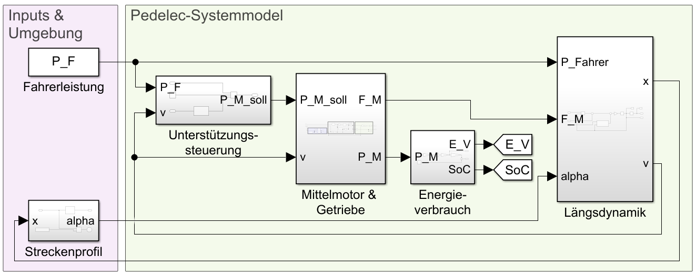

# Pedelec – Modellbasierte Analyse eines mechatronischen Systems

Ziel ist es, anhand eines Pedelecs zu zeigen, wie physikalische Modelle die Auslegung und Bewertung mechatronischer Systeme unterstützen.

Das Projekt umfasst zwei aufeinander aufbauende Untersuchungen:

1. **Stationäre Antriebsauslegung:** Motorleistungsbedarf, Motorgrenzen und zulässige Übersetzungen.
2. **Dynamische Systemsimulation:** Fahrverhalten und elektrischer Energiebedarf bei unterschiedlichen Unterstützungsstrategien.

Die Modelle dienen ausschließlich Lehrzwecken und verwenden vereinfachte, exemplarisch gewählte Parameter.

## 1. Projektdateien

| Datei | Beschreibung |
|---|---|
| `HSBI_Pedelec_Parameter.m` | Gemeinsame Fahrzeug-, Motor- und Batterieparameter |
| `HSBI_Pedelec_Analyse_1.m` | Stationäre Antriebsauslegung in MATLAB |
| `HSBI_Pedelec_Analyse_2.m` | Durchführung und Auswertung der Simulink-Simulation |
| `HSBI_Pedelec_Model.slx` | Dynamisches Pedelec-Gesamtsystemmodell |
| `GPX_Simulink_Profil.mat` | Vorbereitetes Strecken- und Steigungsprofil |

## 2. Voraussetzungen und Verwendung

Benötigt werden:

- MATLAB
- Simulink

Die Dateien sollten gemeinsam in einem MATLAB-Projektverzeichnis liegen.

### Analyse 1 starten

```matlab
run('HSBI_Pedelec_Analyse_1.m')
```

Das Skript berechnet die stationären Motoranforderungen für zwei Betriebsfälle und stellt die zulässigen Gesamtübersetzungen grafisch dar.

### Analyse 2 starten

```matlab
run('HSBI_Pedelec_Analyse_2.m')
```

Das Skript lädt die Modellparameter und Streckendaten, führt zwei Simulink-Simulationen durch und erstellt die Ergebnisdiagramme.

Die Simulationsdaten werden im Signalbus `simData` gespeichert. Er enthält die Signale:

| Signal | Bedeutung | Einheit |
|---|---|---|
| `x` | Zurückgelegte Strecke | m |
| `v` | Fahrgeschwindigkeit | m/s |
| `M_M` | Motorwellenmoment | Nm |
| `P_M` | Mechanische Motorwellenleistung | W |
| `i` | Gesamtübersetzung | – |
| `E_V` | Kumulierter elektrischer Energieverbrauch | Wh |
| `SoC` | Batterieladezustand | – |

## 3. Physikalisches Fahrzeugmodell

Grundlage beider Untersuchungen ist ein vereinfachtes Modell der Fahrzeuglängsdynamik:

$$
m\dot{v}=F_V-F_S-F_R-F_W
$$

Die Vortriebskraft ergibt sich aus den Beiträgen von Motor und Fahrer:

$$
F_V=F_M+F_F
$$

Die Fahrwiderstände werden wie folgt beschrieben:

**Steigungswiderstand**

$$
F_S=mg\sin(\alpha)
$$

**Rollwiderstand**

$$
F_R=c_Rmg\cos(\alpha)
$$

**Luftwiderstand**

$$
F_W=\frac{1}{2}\rho c_w A v^2
$$

Dabei bezeichnen:

| Größe | Bedeutung |
|---|---|
| $m$ | Gesamtmasse einschließlich Fahrer und Gepäck |
| $v$ | Geschwindigkeit in Fahrtrichtung |
| $\alpha$ | Fahrbahnneigungswinkel |
| $g$ | Erdbeschleunigung |
| $c_R$ | Rollwiderstandsbeiwert |
| $\rho$ | Luftdichte |
| $c_w A$ | Luftwiderstandsfläche |
| $F_M$ | Motorische Zugkraft am Rad |
| $F_F$ | Zugkraft durch den Fahrer |

Gegen- und Rückenwind werden nicht berücksichtigt.

## 4. Analyse 1 – Stationäre Antriebsauslegung

### 4.1 Untersuchungsziel

Untersucht wird, ob ein exemplarischer Referenzmotor zwei unterschiedliche Betriebsfälle abdecken kann:

| Betriebsfall | Steigung | Geschwindigkeit |
|---|---:|---:|
| Steigungsfahrt | 9 % | 8 km/h |
| Ebene Fahrt | 0 % | 24 km/h |

Für die stationäre Fahrt gilt:

$$
\dot{v}=0
$$

Damit ergibt sich aus der Kräftebilanz:

$$
F_V=F_S+F_R+F_W
$$

Die motorische Zugkraft wird unter Berücksichtigung des Fahrerbeitrags bestimmt:

$$
F_M=\max\left(0,F_V-\frac{P_F}{v}\right)
$$

Dabei ist $P_F$ die angenommene mechanische Fahrerleistung am Rad. Diese Beziehung gilt für $v>0$.

### 4.2 Motorleistung und Drehmoment

Das motorische Drehmoment am Rad beträgt:

$$
M_{M,\mathrm{Rad}}=F_M r
$$

Die erforderliche mechanische Motorwellenleistung ergibt sich zu:

$$
P_M=\frac{F_Mv}{\eta_G}
$$

Dabei ist $\eta_G$ der angenommene mechanische Übertragungswirkungsgrad zwischen Motorwelle und Antriebsrad.

### 4.3 Übersetzung und Motorgrenzen

Die Gesamtübersetzung ist definiert als:

$$
i=\frac{\omega_M}{\omega_{\mathrm{Rad}}}
$$

Daraus folgen die Motorwinkelgeschwindigkeit

$$
\omega_M=i\frac{v}{r}
$$

und das Motorwellenmoment

$$
M_M=\frac{M_{M,\mathrm{Rad}}}{i\eta_G}
$$

Zur vereinfachten Prüfung werden drei Motorgrenzen betrachtet:

$$
P_M\leq P_{\mathrm{Nenn}}
$$

$$
M_M\leq M_{M,\max}
$$

$$
\omega_M\leq\omega_{M,\max}
$$

Aus der Momentengrenze folgt die untere Grenze für die Gesamtübersetzung:

$$
i\geq\frac{M_{M,\mathrm{Rad}}}{\eta_G M_{M,\max}}
$$

Die Drehzahlgrenze liefert eine obere Grenze:

$$
i\leq\frac{\omega_{M,\max}r}{v}
$$

Für den gewählten Referenzmotor ergeben sich im betrachteten Beispiel näherungsweise:

- Steigungsfahrt: $i\geq 6,49$
- Ebene Fahrt: $i\leq 6,04$

**Ergebnis:** Eine gemeinsame feste Motor-Rad-Übersetzung erfüllt mit diesem Referenzmotor nicht beide Betriebsfälle. Ein Mittelmotor mit schaltbarer Übersetzung kann dagegen geeignete Übersetzungen für beide Fahrzustände bereitstellen.

Diese Aussage bezieht sich ausschließlich auf den gewählten Referenzmotor und die definierten Betriebsfälle. Sie bedeutet nicht, dass Hinterradnabenmotoren grundsätzlich ungeeignet sind.

## 5. Analyse 2 – Dynamische Systemsimulation

### 5.1 Untersuchungsziel

Die zweite Untersuchung erweitert das stationäre Fahrzeugmodell um den zeitabhängigen Fahrbetrieb.

Das Simulink-Modell koppelt:

- Fahrzeuglängsdynamik
- Streckenprofil
- Fahrerleistung
- Unterstützungssteuerung
- Mittelmotor und Übersetzung
- elektrischen Energieverbrauch und Batterie

Die Bewegungsgleichung lautet:

$$
m\dot{v}(t)=F_M(t)+F_F(t)-F_S(t)-F_R(t)-F_W(t)
$$

Die zurückgelegte Strecke ergibt sich aus der Geschwindigkeit:

$$
\dot{x}(t)=v(t)
$$

Die Fahrbahnsteigung wird abhängig von der aktuellen Position aus den vorbereiteten Streckendaten bestimmt:

$$
\alpha(t)=\alpha(x(t))
$$

### 5.2 Unterstützungssteuerung

Die angeforderte mechanische Motorleistung wird durch eine vereinfachte, geschwindigkeitsabhängige Unterstützungsstrategie beschrieben:

$$
P_{M,\mathrm{soll}}=kP_Ff(v)
$$

Die Unterstützungsfaktoren betragen:

| Modus | Faktor $k$ |
|---|---:|
| Eco | 1 |
| Sport | 2,5 |

Die Funktion $f(v)$ reduziert die motorische Unterstützung zwischen 23 und 25 km/h. Ab 25 km/h wird keine zusätzliche Motorleistung mehr angefordert.

Das Motormodell berücksichtigt zusätzlich die angenommenen Momenten-, Drehzahl- und Leistungsgrenzen.

### 5.3 Vereinfachte Gangwahl

Für die dynamische Simulation werden zwei Gesamtübersetzungen verwendet:

$$
i(v)=
\begin{cases}
8, & v\leq15\ \mathrm{km/h}\\
5, & v>15\ \mathrm{km/h}
\end{cases}
$$

Die Gangwechsel werden idealisiert. Ein detailliertes Schaltmodell ist nicht enthalten.

### 5.4 Energieverbrauch und Batterieladezustand

Unter Annahme eines konstanten Motorwirkungsgrades $\eta_M$ ergibt sich die elektrische Leistungsaufnahme zu:

$$
P_{\mathrm{el}}(t)=\frac{P_M(t)}{\eta_M}
$$

Der kumulierte elektrische Energieverbrauch wird aus der Leistungsaufnahme berechnet:

$$
E_V(t)=\int_0^t P_{\mathrm{el}}(\tau)\,d\tau
$$

Dabei wird $P_{\mathrm{el}}$ in Watt und die Zeit in Sekunden verwendet; $E_V$ ergibt sich in Wattstunden (Wh).

Der Batterieladezustand wird im Modell vereinfacht durch folgende Energiebilanz beschrieben:

$$
SoC(t)=SoC_0-\frac{E_V(t)}{E_{\mathrm{Batt,nom}}}
$$

Dabei bezeichnet $E_{\mathrm{Batt,nom}}$ die angenommene Batterienennenergie in Wh.

Der Ladezustand `SoC` wird im MATLAB-Modell als Anteil zwischen 0 und 1 geführt.

### Aufbau des Simulink-Modells

Die zeitabhängige Simulation erfolgt mit dem Modell
`HSBI_Pedelec_Model.slx`. 



*Abbildung: Top-Level-Struktur des Simulink-Modells
für die dynamische Analyse des Pedelecs.*

### 5.5 Referenzstrecke

Die dynamische Simulation verwendet ein vorbereitetes Streckenprofil aus GPX-Daten.

Referenzstrecke: **Paderborn – Hermannsdenkmal – HSBI**

- Streckenlänge: ca. 66,86 km
- Höhenmeter bergauf: ca. 761 m
- Maximale Steigung: ca. +9,9 %
- Minimale Steigung: ca. −11,6 %

Die Streckensteigung wird im Modell positionsabhängig aus der Datei `GPX_Simulink_Profil.mat` eingelesen.

### 5.6 Ergebnisgrößen

Die Simulation ermöglicht unter anderem den Vergleich von:

- Fahrgeschwindigkeit
- Fahrzeit
- Mechanischer Motorleistung
- Motorwellenmoment
- Gangübersetzung
- Elektrischem Energieverbrauch
- Batterieladezustand

Dadurch können die Auswirkungen unterschiedlicher Unterstützungsstrategien auf das Fahrverhalten und den Energiebedarf untersucht werden.

## 6. Modellannahmen und Grenzen

Das Lehrmodell bildet wesentliche physikalische Zusammenhänge ab, stellt jedoch kein vollständig validiertes Serien-Pedelec dar.

Insbesondere gelten folgende Vereinfachungen:

- Konstante Fahrerleistung und vereinfachtes Anfahrverhalten
- Konstante Roll- und Luftwiderstandsparameter
- Kein Gegen- oder Rückenwind
- Konstante mechanische und elektrische Wirkungsgrade
- Vereinfachte, geschwindigkeitsabhängige Gangwahl
- Idealisierte Schaltvorgänge
- Keine aktive Bremsung bei Gefällefahrten
- Vereinfachte Motorgrenzen ohne thermisches Modell
- Vereinfachtes Batteriemodell ohne Alterungs- und Temperatureinflüsse

Die angenommene kurzzeitige Motor-Spitzenleistung ist nicht mit der dauerhaft verfügbaren Nenndauerleistung gleichzusetzen. Das Ende der Motorunterstützung bei 25 km/h begrenzt nicht die Fahrzeuggeschwindigkeit. Insbesondere auf Gefällestrecken können ohne aktive Bremsung deutlich höhere Geschwindigkeiten entstehen.

## 7. Weiterführende Untersuchungen

Das Modell kann beispielsweise erweitert werden um:

- Detaillierte Motorwirkungsgradkennfelder
- Realistischere Gangwahl und Schaltvorgänge
- Brems- und Geschwindigkeitsregelung
- Unterschiedliche Fahrerleistungen und Fahrprofile
- Detaillierte Batteriemodelle
- Vergleich von Simulation und Messfahrten

Das Lehrbeispiel soll zeigen, wie aus einem physikalischen Modell schrittweise ein mechatronisches Gesamtsystemmodell entsteht und wie dieses zur Bewertung konstruktiver Entscheidungen eingesetzt werden kann.
